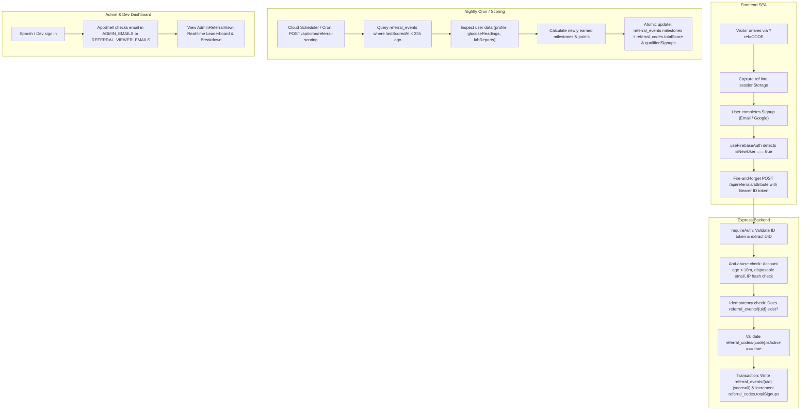

# Applicant Referral Attribution & Progressive Scoring System — Implementation Plan

> **Document Version:** 1.0  
> **Status:** Approved / Ready for Execution  
> **Target Audience:** Engineering, AI Agents, Project Collaborators  
> **Stack:** React 19 + Vite SPA, Express 4 (`server/`), Firebase Auth & Cloud Firestore (Admin SDK + Client SDK), Node.js / TypeScript.

---

## Executive Summary & Business Goals

We are running a paid hiring assessment where **200+ applicants** bring real, legitimate users to the Bluepin health application.
Each applicant receives a unique referral link formatted like:
`https://yourapp.com/?ref=CODE`

### Core Objectives
1. **Accurate Attribution:** Attribute every new signup (Email/Password or Google OAuth) to the referring applicant's code.
2. **Progressive Server-Side Qualification:** Rather than a binary pass/fail, evaluate user engagement milestones over time (e.g. completed onboarding, 3 days of glucose logging, lab report uploaded, WhatsApp connected, 7 days active) to compute an applicant leaderboard score (up to 9 points per user).
3. **Anti-Abuse Protections:** Prevent fake accounts, multi-accounting on the same device/IP, disposable emails, and retroactively claiming existing users.
4. **Zero Impact on Production Database:** The production database already has active real users. All database modifications must strictly isolate new data in distinct, dedicated collections (`referral_codes`, `referral_events`) with zero mutations or schema disruptions to existing collections (`users`, `glucoseReadings`, `labReports`, etc.).
5. **Future-Proofing for Affiliate Dashboards:** Structure schemas, APIs, and access levels so self-service portals, link generation, and affiliate payouts can be added without database migrations or rework.

---

## Critical Production Safety & Non-Disruption Guarantees

> [!CAUTION]
> **Active Production Users Safeguards:**
> - **Zero Mutations to Existing Collections:** The referral system will **never** alter existing user documents or schema structure inside `users/{uid}`, `families/{id}`, `feedbacks/{id}`, etc.
> - **Completely Isolated Collections:** All referral data lives strictly in:
>   - `referral_codes/{code}` (admin / applicant codes)
>   - `referral_events/{uid}` (one record per attributed user, keyed by `uid`)
> - **Read-Only Inspection of Existing User Data:** The scoring engine only **reads** `users/{uid}`, `users/{uid}/glucoseReadings`, and `users/{uid}/labReports` to verify engagement milestones. It never modifies them.
> - **Existing Users Cannot Be Attributed:** Any user account with Firebase Auth `metadata.creationTime` older than 10 minutes at the time of attribution will be strictly rejected.
> - **Non-Blocking Client Attribution:** Frontend attribution calls are executed as non-blocking, fire-and-forget background requests. If attribution fails or the network drops, onboarding and normal user experience are never blocked.

---

## System Architecture Diagram



---

## Detailed Data Model Specification

### 1. `referral_codes/{code}`
*One document per applicant code (uppercase alphanumeric, e.g., `PRIYA2024`).*

```typescript
export interface ReferralCode {
  code: string;               // Normalized uppercase referral code (Document ID)
  applicantName: string;      // Human-readable applicant name
  applicantEmail: string | null; // For communication and future self-service affiliate login
  createdAt: number;          // Epoch milliseconds
  createdBy: string;          // "import-script" or admin UID
  isActive: boolean;          // Set false to revoke/pause code

  // Denormalized aggregated counters (maintained server-side via FieldValue.increment)
  totalSignups: number;       // All attributed accounts
  qualifiedSignups: number;   // Users reaching at least Onboarding milestone (score >= 1)
  totalScore: number;         // Sum of all progressive points earned by referred users
}
```

### 2. `referral_events/{uid}`
*One document per attributed referred user. Keyed by Firebase Auth `uid` for strict idempotency.*

```typescript
export interface ReferralMilestone {
  achievedAt: number;         // Epoch milliseconds when milestone criteria was confirmed
}

export interface ReferralEvent {
  uid: string;                // Document ID (matches Firebase Auth user UID)
  refCode: string;            // The uppercase referral code that brought them
  attributedAt: number;       // Epoch milliseconds when user signed up and attributed
  signupMethod: "Email" | "Google";
  lastScoredAt: number;       // Epoch timestamp of last evaluation pass
  score: number;              // Current cumulative score (0 to 9)

  // Milestones: recorded once, never overwritten
  milestones: {
    onboarded?: ReferralMilestone;         // +1 pt
    glucose3days?: ReferralMilestone;      // +2 pts
    labReportUploaded?: ReferralMilestone; // +2 pts
    whatsappLinked?: ReferralMilestone;    // +1 pt
    active7days?: ReferralMilestone;       // +3 pts
  };

  // Anti-abuse telemetry (server-only, never exposed in client UI)
  _ipHash: string;            // SHA-256 of user IP at attribution
  _userAgent: string;
  _disqualifyReason?: string; // Reason string if flagged for abuse/disqualification
}
```

---

## Milestone & Progressive Scoring Matrix

| Milestone Key | Points | Server-Side Validation Rule | Business Significance |
| :--- | :---: | :--- | :--- |
| `onboarded` | **+1** | Profile exists and `users/{uid}.name` is non-empty string | Completed baseline setup; valid user |
| `glucose3days` | **+2** | At least 3 distinct calendar dates found in `users/{uid}/glucoseReadings` | Verified active logging behavior |
| `labReportUploaded` | **+2** | At least 1 document exists in `users/{uid}/labReports` | Engaged with core diagnostic features |
| `whatsappLinked` | **+1** | Profile `users/{uid}.whatsappPhone` is present | High retention touchpoint established |
| `active7days` | **+3** | At least 7 distinct calendar dates across `glucoseReadings` and `labReports` | Highly retained, sticky user |

**Maximum Possible Score per User:** 9 points.  
**Leaderboard Ranking:** Primary sort by `totalScore` descending, secondary sort by `qualifiedSignups` descending.

---

## Phase-by-Phase Implementation Plan

### Phase 0: Bulk Seeding Script (200+ Applicants from CSV)

**File to create:** `scripts/seed-referral-codes.ts`  
**Purpose:** One-time and repeatable idempotent import of applicants from spreadsheet export.

- Add dev dependency `csv-parse` (`npm i -D csv-parse`).
- Expected CSV format:
  ```csv
  code,applicantName,applicantEmail
  PRIYA2024,Priya Sharma,priya@example.com
  RAHUL2024,Rahul Mehta,rahul@example.com
  ```
- Uses Firestore batch writes (chunked into 400 operations per batch).
- Uses `{ merge: true }` so re-running the script when new applicants join preserves existing counters (`totalSignups`, `totalScore`).

---

### Phase 1: Access Control & Middleware

**File to create:** `server/middleware/requireAdmin.ts`

To allow the developer to test and monitor referral tracking without needing full administrative control over user feedbacks or sensitive operations, implement two clear authorization tiers:

```typescript
// Full admin access: management of codes, full feedback & system oversight
export const ADMIN_EMAILS = new Set([
  "sparsh@bluepin.in",
]);

// Read-only / tracking viewers: can inspect referral summaries & analytics
export const REFERRAL_VIEWER_EMAILS = new Set([
  "sparsh@bluepin.in",
  // Developer email to be inserted here
]);
```

- `requireAdmin`: Checks `req.user.email` in `ADMIN_EMAILS`.
- `requireReferralAccess`: Checks `req.user.email` in `REFERRAL_VIEWER_EMAILS` (or `ADMIN_EMAILS`).

---

### Phase 2: Express Backend APIs & Scoring Engine

#### 1. Route: `server/routes/referrals.ts`
Mounted in `server/routes/index.ts` under `/api/referrals`:

- `POST /api/referrals/attribute`
  - Protected with `requireAuth`.
  - Extracts `uid` and `email` from `req.user`.
  - Checks if `referral_events/{uid}` exists; returns `{ alreadyAttributed: true }` if so.
  - Verifies account age via `getAuth().getUser(uid)` (`metadata.creationTime` within last 10 minutes).
  - Verifies `referral_codes/{code}` exists and `isActive === true`.
  - Verifies email is not from disposable domain blocklist.
  - Writes initial `referral_events/{uid}` with `score: 0`, `milestones: {}`, and `_ipHash`.
  - Atomically increments `referral_codes/{code}.totalSignups` by 1.

- `GET /api/referrals/admin/summary`
  - Protected with `requireAuth` + `requireReferralAccess`.
  - Returns array of all referral codes sorted by `totalScore` descending.
  - Supports optional query `?code=XYZ` to fetch detailed `referral_events` list under that code.

- `POST /api/referrals/admin/codes`
  - Protected with `requireAuth` + `requireAdmin`.
  - Creates a single new code dynamically without running the CSV script.

#### 2. Service: `server/services/referralScorer.ts`
Pure function that takes a `ReferralEvent` and Firestore database instance:
- Inspects target user's profile and subcollections (`glucoseReadings`, `labReports`).
- Evaluates which unearned milestones are now met.
- Calculates `pointsEarned` and returns `newMilestones`.

#### 3. Cron Job: Update `server/routes/cron.ts`
- Adds endpoint `POST /api/cron/referral-scoring`.
- Secured via `CRON_SECRET` header check (same pattern as `/api/cron/whatsapp-reminders`).
- Queries `referral_events` where `lastScoredAt < Date.now() - 23 * 3600 * 1000`.
- Executes `scoreReferralEvent` for each.
- In batched writes:
  - Updates `referral_events/{uid}` with new milestones, new `score`, and updated `lastScoredAt`.
  - Increments `referral_codes/{code}.totalScore` by `pointsEarned`.
  - If `onboarded` milestone was newly attained, increments `referral_codes/{code}.qualifiedSignups` by 1.

---

### Phase 3: Frontend Integration

#### 1. Referral Helper: `src/lib/referral.ts`
- `captureReferralCode()`: Extracts `ref` parameter from `window.location.search`, trims/uppercases, and persists to `sessionStorage.setItem("pending_ref", code)`.
- `consumeReferralCode()`: Retrieves pending code from `sessionStorage`.
- `clearReferralCode()`: Cleans up `pending_ref`.
- `attributeReferral(idToken: string)`: Asynchronous non-blocking `fetch("/api/referrals/attribute")`. Clears storage on success.

#### 2. App Boot Capture: `src/main.tsx`
Call `captureReferralCode()` at top-level initialization before rendering React root.

#### 3. Auth Hook Wiring: `src/hooks/useFirebaseAuth.ts`
- In `signUpWithEmail`: When a new user credential is created, invoke `attributeReferral(idToken)`.
- In `signInWithGoogle`: When `isNewUser === true`, invoke `attributeReferral(idToken)`.
- Never `await` or block navigation; let onboarding proceed instantaneously.

---

### Phase 4: Admin Dashboard UI

**File to create:** `src/components/AdminReferralView.tsx`  
**Integration:** Update `src/components/layout/AppShell.tsx` and admin navigation.

- Follows the exact split-pane UI structure of `src/components/AdminFeedbackView.tsx`.
- **Left Pane:** Leaderboard displaying rank medal, applicant name, referral code, signups count, qualified count, and total score. Filterable by code or search query.
- **Right Pane:** Selected applicant breakdown showing attributed user records, date of attribution, signup method, milestone checklist badges (Onboarded, 3-Day Glucose, Lab Report, WhatsApp, 7-Day Active), and current score.
- **Access Gating:** Tab is rendered if current user's email is present in the allowed set.

---

### Phase 5: Firestore Security Rules

Update `firestore.rules` at the project root to guarantee complete lockdown against direct client manipulation:

```firestore
// referral_codes: Completely locked down to client SDKs. Read/write strictly via Admin SDK.
match /referral_codes/{code} {
  allow read, write: if false;
}

// referral_events: Server-managed. Authenticated users may only read their own attribution record.
match /referral_events/{uid} {
  allow read: if request.auth != null && request.auth.uid == uid;
  allow write: if false;
}
```

---

### Phase 6: Anti-Abuse Protections

1. **Account Age Verification:** Reject attribution if user account creation is older than 10 minutes.
2. **Disposable Email Detection:** Block known disposable domains (e.g. `tempmail.com`, `mailinator.com`, `guerrillamail.com`).
3. **IP Hashing & Clustering:** Compute SHA-256 hash of client IP. Flag multiple signups originating from identical IP hashes within short windows.
4. **Existing Rate Limits:** All routes sit behind the existing Express `globalIpLimiter` (100 requests per 15 minutes per IP).

---

## Future-Proofing for Affiliate Portal

The data model and architecture seamlessly support future self-service affiliate portals without breaking changes:
- `referral_codes.applicantEmail` is already indexed and ready for self-service affiliate authentication.
- Read endpoint `/api/referrals/summary?code=XYZ` can be exposed to authenticated affiliates to inspect only their individual performance.
- Progressive scoring structure can map directly to commission tiers (e.g., ₹50 on onboarding, ₹150 on 3-day glucose, ₹300 on 7-day retention).

---

## File Modification Summary

| File Path | Action | Description |
| :--- | :---: | :--- |
| `REFERRAL_ATTRIBUTION_PLAN.md` | **Create** | Project-root documentation of this complete specification |
| `scripts/seed-referral-codes.ts` | **Create** | CSV batch seeder for 200+ applicants |
| `server/middleware/requireAdmin.ts` | **Create** | Multi-email admin and tracking authorization middleware |
| `server/routes/referrals.ts` | **Create** | Attribution, summary, and code generation API endpoints |
| `server/services/referralScorer.ts` | **Create** | Progressive qualification milestone scoring service |
| `server/routes/cron.ts` | **Modify** | Add `/cron/referral-scoring` endpoint |
| `server/routes/index.ts` | **Modify** | Mount `referrals` router |
| `src/lib/referral.ts` | **Create** | URL capture, storage, and non-blocking attribution helper |
| `src/main.tsx` | **Modify** | Invoke `captureReferralCode()` on initial application boot |
| `src/hooks/useFirebaseAuth.ts` | **Modify** | Trigger `attributeReferral` on new user signup / Google sign-in |
| `src/components/AdminReferralView.tsx` | **Create** | Split-pane leaderboard and breakdown admin UI |
| `src/components/layout/AppShell.tsx` | **Modify** | Render referral tab in admin navigation for authorized emails |
| `firestore.rules` | **Modify** | Secure `referral_codes` and `referral_events` collections |
